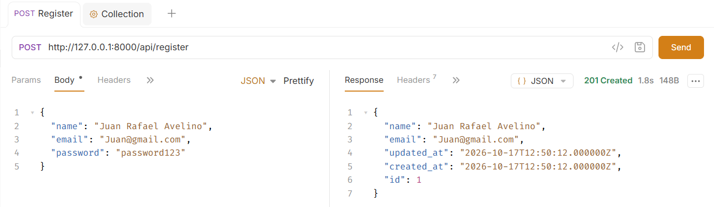
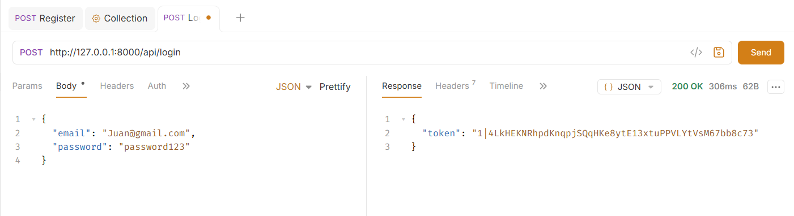

# Games API

**Section:** IT3E
**Resource:** Game (title, genre, platform, price, release_year)

## Setup
1. composer install
2. cp .env.example .env
3. php artisan key:generate
4. touch database/database.sqlite   (if not already present)
5. php artisan migrate
6. php artisan serve

## Routes
| Verb | Path | What it does | Token? |
|---|---|---|---|
| POST | /api/register | Create a user | No |
| POST | /api/login | Get a token | No |
| POST | /api/logout | Revoke current token | Yes |
| GET | /api/me | Current user | Yes |
| GET | /api/games | List games (filters: genre, platform, release_year) | Yes |
| POST | /api/games | Create a game | Yes |
| GET | /api/games/{game} | Show one game | Yes |
| PUT | /api/games/{game} | Update a game | Yes |
| DELETE | /api/games/{game} | Delete a game | Yes |

## Screenshots
### 1. Register (201)

### 2. Login (200)

### 3. games with no token (401)
 .png)
### 4. games with token(200)

### 5. Create game (201)

### 6. Create game with missing fields (422)

### 7. List game (200)

### 8. List game with invalid id (404)

### 9. Update game (200)

### 10. Delete game (204)

... through 10

## Why does DELETE return 204?
(your own words)
